# Unify Syslog Server

A central syslog server built specifically for UniFi. All UniFi sites send their syslog to one server, which recognizes firewall, IPS, Wi-Fi, DHCP, DNS, VPN, switch and management messages, enriches them with fields (source, destination, port, rule, client, SSID…) and makes them searchable and visible in a dashboard.

- **Receiver**: UDP and TCP on port 514 (RFC3164, RFC5424, RFC6587 framing).
- **UniFi parser**: device name `model,mac,version`, iptables rule tags (`WAN_IN-D-3001`, `DESCR="..."`), CEF from UniFi Network SIEM, hostapd/stahtd, dnsmasq/kea DHCP, DNS, Suricata IPS, WireGuard/OpenVPN/IPsec, SSH logins, switch ports and `EVT_*` controller codes.
- **Storage**: ClickHouse (columnar storage, compression, billions of rows), daily partitions and a configurable retention period. Metadata in SQLite.
- **Dashboard**: messages per category, blocked sources and ports, IPS signatures, Wi-Fi clients, SSIDs, DHCP clients, devices and sites. Click through to the logs.
- **Search**: a dedicated query language with fields, CIDR, ranges and wildcards, live tail, and export to CSV and JSON.
- **Categories**: create your own categories (a saved search with a color) to filter logs.
- **Sites**: map source IPs to a site, manually or via IP ranges. Sites behind NAT work too. An overview shows, per site, the status, devices and logs, blocks, IPS alerts and errors of the last 24 hours.
- **Devices**: a persistent inventory of all UniFi devices (by MAC address, so also behind NAT), with a custom name and notes, firmware per model and updated firmware. Devices that have not sent logs for too long are marked as *silent* and, optionally, reported by email, as is their return.
- **Alerts**: email when a search exceeds a threshold.
- **Microsoft Entra SSO** (OIDC + PKCE), with groups mapped to roles (admin or viewer).
- **Mail**: your own SMTP server with STARTTLS or TLS, minimum TLS 1.2/1.3, and PLAIN, LOGIN, CRAM-MD5, SCRAM-SHA-256 or OAuth2 (Microsoft 365).
- **Backup**: full and incremental backups to FTP, FTPS, SCP or a local folder, with scheduling, retention policy and restore from the remote location.
- **Branding**: your company name and logo (separate light and dark mode variants) and favicon in the menu, on the sign-in page and in e-mails.
- **Languages**: English and Dutch. Each user picks their own language; Entra SSO users get the language of their Microsoft account. E-mails are sent in the language of the recipient.
- **Updates**: the Info button shows the version, checks for updates and installs them from the interface.
- The web interface runs on **port 8080**.

## Screenshots

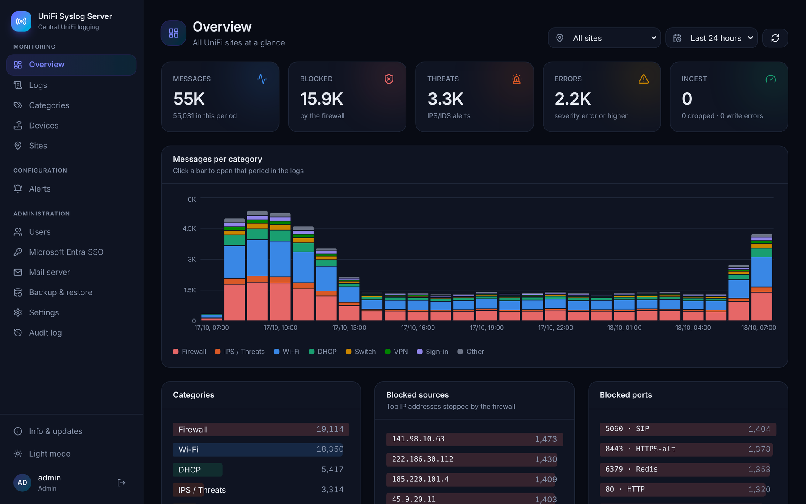

| | |
|---|---|
| 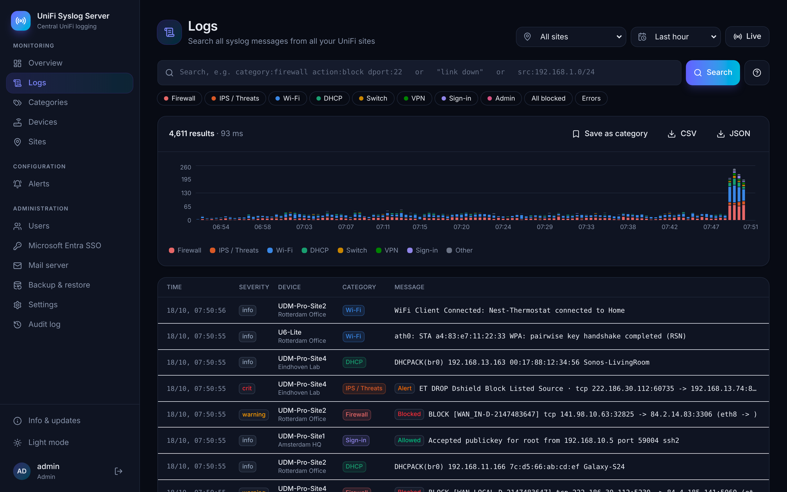<br>**Logs**: search with the query language, histogram, live tail and CSV/JSON export. | 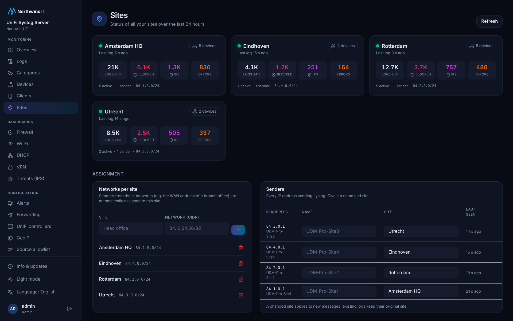<br>**Sites**: status per site over the last 24 hours, and sender-to-site mapping. |
| 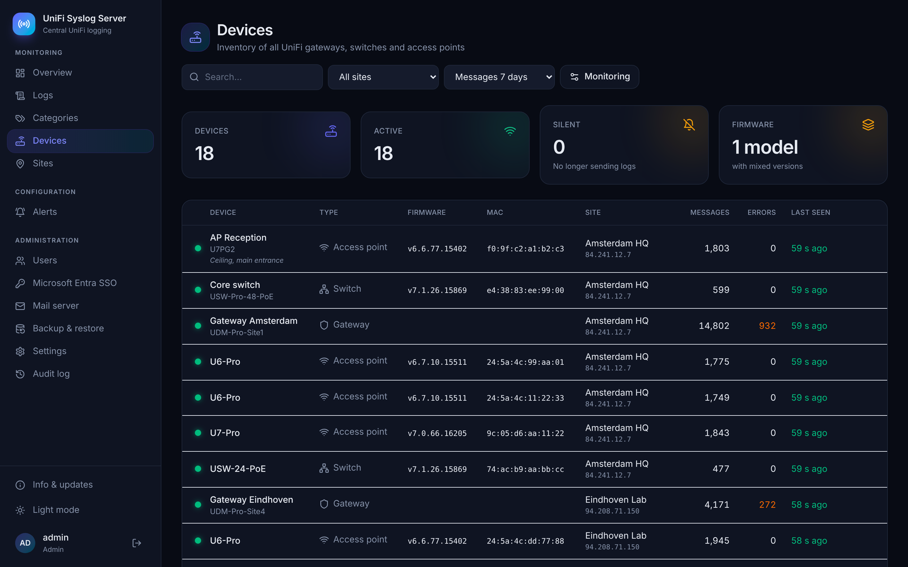<br>**Devices**: inventory of gateways, switches and access points with firmware and silent-device monitoring. | 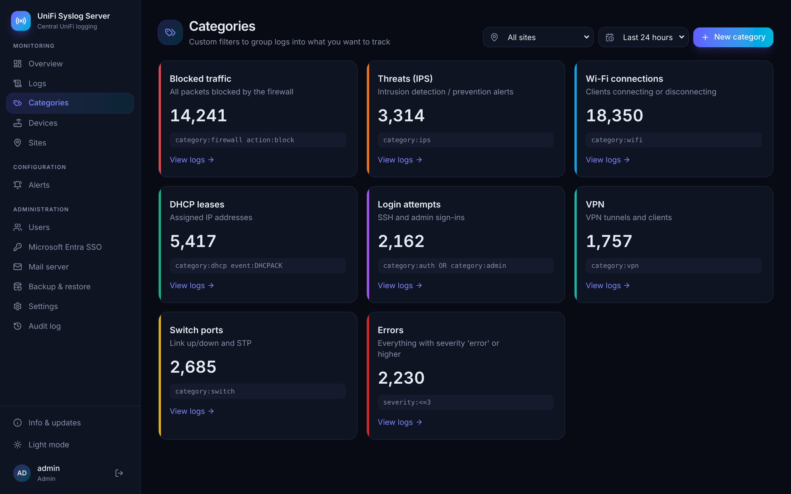<br>**Categories**: saved searches with a color, used as filters. |
| 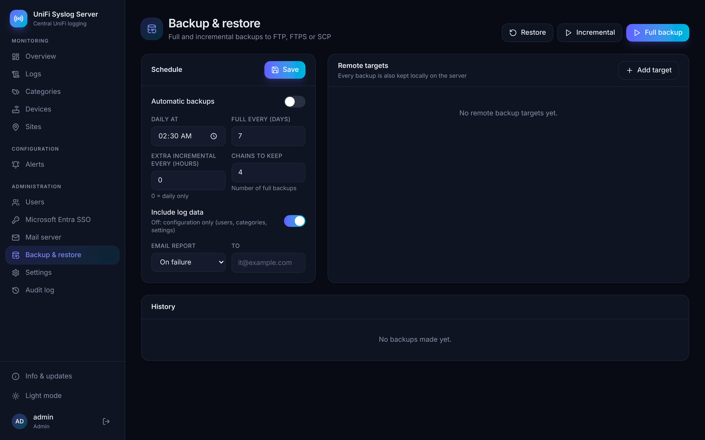<br>**Backup & restore**: full and incremental backups to FTP, FTPS or SCP. | 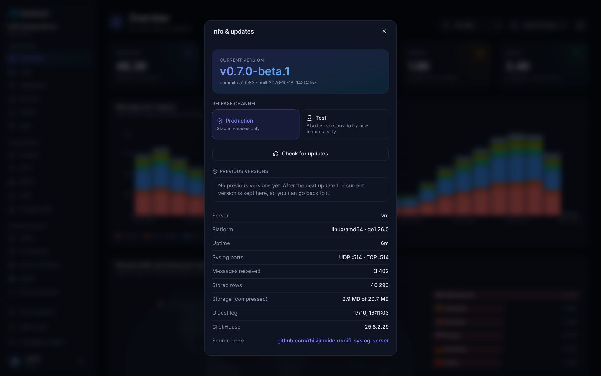<br>**Info & updates**: current version, update check and in-app update. |
| 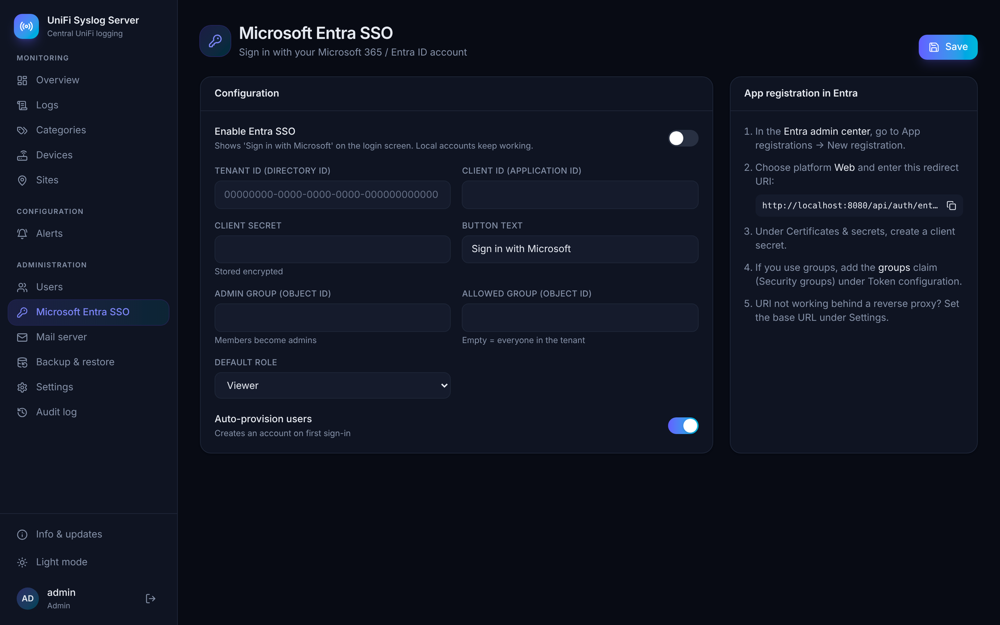<br>**Microsoft Entra SSO** with group-to-role mapping. | 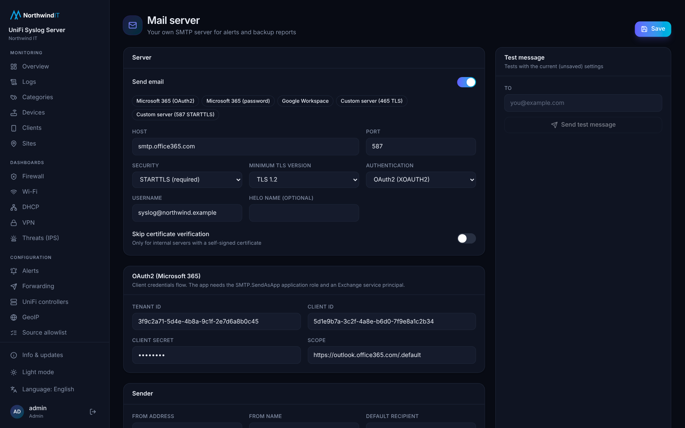<br>**Mail server**: your own SMTP server with modern TLS and authentication. |
| 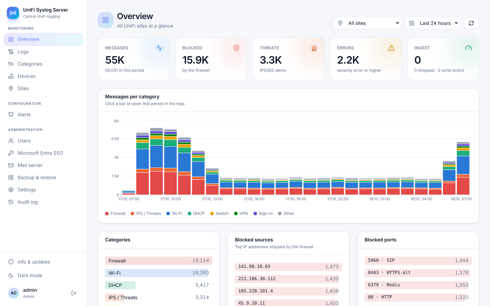<br>**Light mode**. | 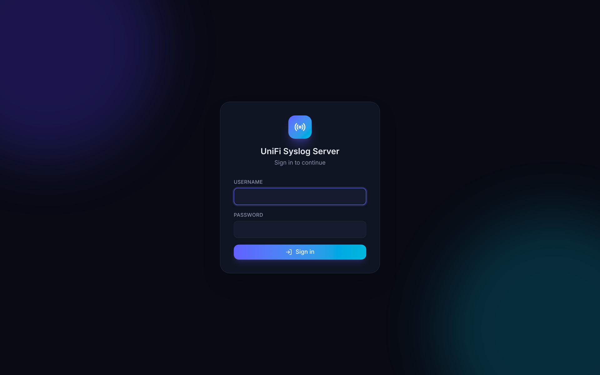<br>**Sign in** page. |

The screenshots show simulated UniFi traffic from four sites (`unify-syslog simulate`).

## Installation

### Proxmox LXC

Run this on the Proxmox host:

```bash
bash -c "$(curl -fsSL https://raw.githubusercontent.com/rhisijmuiden/unify-syslog-server/main/ct/unify-syslog-server.sh)"
```

The script uses the community-scripts engine and creates an unprivileged Debian 13 container (by default 4 vCPU, 4 GB RAM and a 40 GB disk). Use *Advanced* to change this. Size the disk to your expected volume: with UniFi logs that is roughly 1 GB per 10 million messages after compression.

You can update the container later by running the same command inside the container, or with the **Info** button in the web interface.

### Debian 13 (VM or physical server)

Run this as root:

```bash
curl -fsSL https://raw.githubusercontent.com/rhisijmuiden/unify-syslog-server/main/deploy/install.sh | bash
```

The install script:

1. installs and configures ClickHouse (reachable on localhost only, with its own user and password);
2. downloads the latest release and verifies the checksum;
3. installs a systemd service `unify-syslog`;
4. creates an admin account and writes the credentials to `/root/unify-syslog.creds`.

You can adjust its behavior with these environment variables:

| Variable | Meaning |
|---|---|
| `USS_VERSION=v0.1.0` | Installs a specific version instead of the latest. |
| `USS_ADMIN_PASSWORD=...` | Sets the initial admin password (generated otherwise). |
| `USS_NONINTERACTIVE=1` | Skips all prompts. |
| `USS_CH_MEMORY_RATIO=0.5` | Sets the share of RAM that ClickHouse may use. |

Then open `http://<server>:8080`.

### Files

| Path | Contents |
|---|---|
| `/etc/unify-syslog/config.yaml` | Ports, ClickHouse connection and ingest settings. |
| `/var/lib/unify-syslog/` | Metadata (`meta.db`), the encryption key (`secret.key`) and local backups. |
| `/opt/unify-syslog/` | The program. |

## Configuring UniFi

**UniFi Network (controller, UDM, UCG, Cloud Key)**

1. Go to *Settings → CyberSecure → Traffic Logging* (in older versions *Settings → System → Advanced → Remote Logging*).
2. Choose **SIEM Server** or **Syslog**, enter the IP address of this server, use port `514` and save.
3. Enable **Syslog Logging** on the firewall rules you want to see.
4. To also receive debug messages from the devices, enable *Debug Logs*.

**Multiple sites**: each site sends to the public IP or the VPN tunnel of this server. Then go to **Sites** in the interface and map each source IP (for example the WAN IP of a branch office) or IP range to a site name.

## Query language

| Example | Meaning |
|---|---|
| `category:firewall action:block` | Blocked firewall traffic. |
| `src:203.0.113.0/24` | Source IP in a subnet. |
| `dport:22 OR dport:3389` | SSH or RDP. |
| `-category:dns` | Everything except DNS. |
| `rule:"WAN_IN-D-*"` | A wildcard. |
| `severity:<=warning` | Severity warning or higher. |
| `dport:1..1024` | A port range. |
| `ssid:"Office" client:aa:bb:*` | An SSID and clients with a MAC prefix. |
| `"authentication failure"` | An exact phrase in the message. |
| `field.signature_id:2210050` | An extra field from the parser. |

You can search on these fields:

| Group | Fields |
|---|---|
| General | `category`, `app`, `host`, `site`, `source`, `severity`, `facility`, `msg`, `raw` |
| Device | `model`, `mac`, `firmware` |
| Event | `action`, `rule`, `event` |
| Traffic | `src`, `dst`, `sport`, `dport`, `proto`, `in`, `out`, `ip` (source or destination), `port` |
| Clients | `client`, `client_name`, `client_ip`, `ssid` |

## Branding

Under **Administration → Branding** you set a company name and upload a logo for light mode, an optional logo for dark mode and a favicon (PNG or SVG, ICO for the favicon, at most 512 KB each). The company name appears below the server name in the menu and on the sign-in page, and in the header and footer of every e-mail. E-mails embed the logo only when it is a PNG, because most mail clients do not show SVG. Branding is stored in the configuration database, so it is part of every backup.

## Languages

The interface and e-mails are available in English and Dutch.

- The server default is set under **Settings → Default language**; it applies to the sign-in page and to users who have not picked a language.
- Every user can pick their own language at the bottom of the menu, and admins can set it per user.
- Entra SSO users get the language of their Microsoft account on every sign-in, until they pick a language themselves. This uses the delegated Graph permission `User.Read` (or the optional `xms_pl` claim) and can be turned off on the SSO page.
- E-mails go out in the language of the user with the recipient's address, otherwise in the server default.

To add a language, copy `web/src/locales/nl.json` (interface) and `internal/i18n/locales/nl.json` (e-mails) to `<code>.json`, translate the values and set `_language` to the language's own name. Keys are the English texts; a missing key falls back to English. New files are picked up automatically when building. `npm run i18n:check` in `web/` lists interface texts that a translation is missing.

## Backup and restore

Configure backups under **Backup** in the web interface.

- **Full backup**: all logs plus the configuration (users, settings, categories and the encryption key).
- **Incremental backup**: only what has arrived since the previous backup in the chain.
- **Restore**: choose a backup at the remote location. The server fetches the whole chain (the full backup plus the incremental backups), restores the logs and restarts.

A backup contains the encryption key, so store backups in a trusted location.

## Command line

```bash
unify-syslog user add jan --admin       # create a user
unify-syslog user passwd admin          # reset a password
unify-syslog update [--check]           # update to the latest release
unify-syslog simulate --target 127.0.0.1:514 --rate 500 --sites 3   # test traffic
unify-syslog version
```

## Building from source

Requirements: Go 1.26 and Node 22.

```bash
make web      # build the React UI (web/dist, embedded in the binary)
make build    # bin/unify-syslog
make test
make dist     # release tarballs for amd64 and arm64 with checksums.txt
```

A `v*` tag makes GitHub Actions create a release. The install script and the updater use that release.

## Architecture

```
UniFi devices ──UDP/TCP 514──▶ syslogd ─▶ ingest workers (UniFi parser, site)
                                            │ batches of 20k / 1 s
                                            ▼
                     ClickHouse  logs (MergeTree, TTL) + logs_hourly (MV)
                                            ▲
     Browser ──HTTP 8080──▶ API + React UI ─┘   SQLite: users, settings, sites
```
